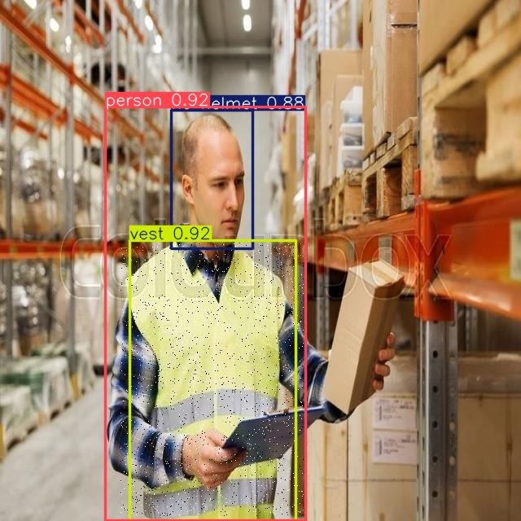

# PPE Detection với YOLO11s

Nhận diện trang bị bảo hộ lao động bằng YOLO11s với 8 lớp: **boots**, **helmet**,
**helmet on**, **no boots**, **no helmet**, **no vest**, **person** và **vest**.
Repository gồm các notebook xử lý dữ liệu, huấn luyện trên
Kaggle, kết quả thực nghiệm và code chạy dự đoán trên ảnh, video, webcam.

## Kết quả thực nghiệm

Kết quả từ lần chạy `ppe_yolo11s-2` trên dataset PPE-5 ngày 18/11/2026.
Dataset có 3.537 ảnh train và 555 ảnh validation; Ultralytics sử dụng **3.525 ảnh
train và 552 ảnh validation** sau khi bỏ qua 12/3 ảnh có nhãn trộn polygon và bounding box.

| Model | Params (M) | GFLOPs | Precision | Recall | F1 | mAP50 | mAP50–95 | Latency (ms/ảnh) |
| --- | ---: | ---: | ---: | ---: | ---: | ---: | ---: | ---: |
| YOLO11s | 9.4159 | 21.4349 | 0.6098 | 0.8041 | 0.6829 | 0.7028 | 0.4426 | 10.3133 |

Các chỉ số P/R/F1/mAP sử dụng thang 0–1. Params và GFLOPs được tính trên model sau
fuse, input 640 × 640. Latency là thời gian inference trung bình mỗi ảnh khi
validation trên Tesla T4, batch 16, FP32; chưa bao gồm đọc/ghi file, preprocess và
postprocess. Chưa có kết quả đánh giá trên tập test độc lập.

Chi tiết cấu hình, kết quả từng lớp và biểu đồ: [Báo cáo YOLO11s](reports/yolo11s/README.md).

### Ví dụ dự đoán trên tập validation



## Cấu trúc dự án

```text
PPE-Detection/
├── configs/                 # Cấu hình dataset
├── models/yolo11s/          # Metadata và vị trí đặt best.pt
├── notebooks/              # EDA, tiền xử lý và huấn luyện
├── reports/yolo11s/         # Metrics, biểu đồ và ảnh dự đoán
├── src/                    # Train, evaluate, predict và các hàm dùng chung
├── main.py                 # Chạy các chức năng từ dòng lệnh
├── requirements.txt        # Thư viện chạy model
└── requirements-notebooks.txt
```

Dataset, trọng số và kết quả chạy local trong `runs/` được Git bỏ qua.

## Cài đặt

Sử dụng Python 3.11 hoặc 3.12. Các lệnh dưới đây chạy bằng PowerShell:

```powershell
git clone --branch feature/yolo11 https://github.com/DuyDQ206/PPE-Detection.git
cd PPE-Detection
python -m venv .venv
.venv/Scripts/Activate.ps1
python -m pip install -r requirements.txt
```

Trên Linux/macOS, kích hoạt môi trường bằng `source .venv/bin/activate`.
Để chạy các notebook, cài thêm:

```powershell
python -m pip install -r requirements-notebooks.txt
```

## Chuẩn bị trọng số

Giải nén `ppe_yolo11s-2_results.zip` và chép file `ppe_yolo11s-2/weights/best.pt` vào:

```text
models/yolo11s/best.pt
```

File `.pt` không được lưu trực tiếp trong Git. Có thể kiểm tra checkpoint bằng
SHA256 và đối chiếu với [metadata.json](models/yolo11s/metadata.json):

```powershell
Get-FileHash models/yolo11s/best.pt -Algorithm SHA256
```

## Chạy dự đoán

Chạy từ thư mục gốc dự án sau khi đã đặt trọng số đúng vị trí:

```powershell
# Ảnh, chạy trên CPU
python main.py predict --source "path/to/image.jpg" --device cpu

# Video, chạy trên GPU NVIDIA
python main.py predict --source "path/to/video.mp4" --device 0

# Webcam
python main.py predict --source 0 --show --device 0
```

Confidence mặc định là 0.5, có thể thay bằng `--conf 0.25`. Ảnh/video dự đoán và
nhãn kèm confidence được lưu trong `runs/predict/`.

## Chuẩn bị dữ liệu

Đặt dataset đã tiền xử lý trong `data/preprocessed/`:

```text
data/preprocessed/
├── train/
│   ├── images/
│   └── labels/
├── valid/
│   ├── images/
│   └── labels/
└── test/                   # Cần khi đánh giá với --split test
    ├── images/
    └── labels/
```

Nhãn ở định dạng YOLO: `class_id x_center y_center width height`, tọa độ chuẩn hóa
về 0–1. Mapping lớp phải khớp [configs/ppe8.yaml](configs/ppe8.yaml):

| ID | Lớp |
| ---: | --- |
| 0 | boots |
| 1 | helmet |
| 2 | helmet on |
| 3 | no boots |
| 4 | no helmet |
| 5 | no vest |
| 6 | person |
| 7 | vest |

Đây là mapping 8 lớp của checkpoint mới; dataset và checkpoint phải dùng cùng ID.
Nếu train lại, cần chuẩn hóa nhãn detection về 5 cột để xử lý các cảnh báo polygon/bounding box
đã xuất hiện trong lần chạy này.

Nếu dataset nằm ở thư mục khác, truyền `--data-root "path/to/dataset"`.
Dùng `--data "path/to/data.yaml"` để chọn YAML riêng; path tương đối trong YAML
được tính theo vị trí file. YAML cần khai báo `train`, `val` và `names`.

## Đánh giá model

```powershell
python main.py evaluate --split val --device cpu
```

Để đánh giá tập test đã chuẩn bị riêng:

```powershell
python main.py evaluate --split test --device 0
```

Kết quả được lưu trong `runs/evaluate/`:

- `metrics_summary.csv`: Params, GFLOPs, Precision, Recall, F1, mAP50, mAP50–95 và latency.
- `summary.json`: kết quả và thông tin môi trường đo.
- `per_class_metrics.csv`: các chỉ số theo từng lớp.
- Confusion matrix và các đường cong đánh giá.

## Huấn luyện

```powershell
python main.py train --epochs 100 --batch 16 --imgsz 640 --device 0
```

Mặc định dùng pretrained `yolo11s.pt`, seed 42 và patience 20. Checkpoint được lưu
trong `runs/train/ppe_yolo11s*/weights/`. Lần train trên Kaggle chạy đủ 100 epochs;
mAP50–95 validation trong lịch sử train cao nhất tại epoch 92.

Các notebook của dự án:

1. [Khảo sát dữ liệu](notebooks/01_eda.ipynb)
2. [Tiền xử lý dữ liệu](notebooks/02_data_preprocessing.ipynb)
3. [Huấn luyện YOLO11s trên Kaggle](notebooks/03_training_yolo11_kaggle.ipynb)

Notebook đã chạy trên `/kaggle/input/datasets/duydq206/ppe5-data/ppe-5/data` và giữ
output thực thi mới. Bảng kết quả và checkpoint metadata tương ứng với lần chạy này.
Phần predict của notebook xử lý từng ảnh validation với `conf=0.5`; chưa tuning confidence trên valid
hoặc predict/evaluate trên test.

Xem các tùy chọn bằng `python main.py train --help`, `python main.py evaluate --help`
hoặc `python main.py predict --help`.

## Giới hạn

Hai lớp **no boots** và **helmet on** có mAP50 thấp nhất trong lần chạy này.
Tên lớp được giữ đúng theo dataset, chưa gộp hoặc đổi nghĩa các nhãn.
Kết quả validation chưa đủ để khẳng định chất lượng trên dữ liệu camera thực tế;
cần đánh giá test độc lập và xử lý các nhãn bị cảnh báo trước khi kết luận thêm.
