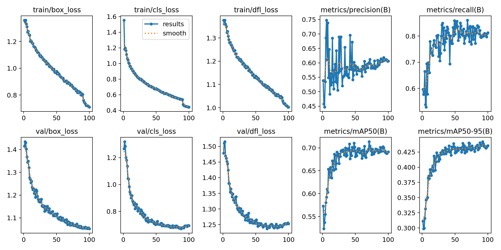
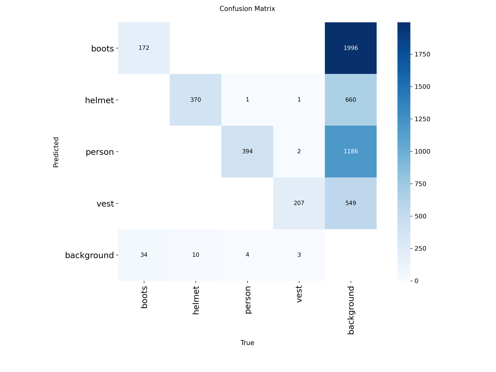

# Kết quả YOLO11s trên validation

Nguồn: `ppe_yolo11s_results (1).zip`, notebook Kaggle chạy ngày 17/11/2026.
Trọng số và ZIP được nhận diện bằng SHA256 trong `models/yolo11s/metadata.json`.

| Params (M) | GFLOPs | P | R | F1 | mAP50 | mAP50–95 | Latency inference (ms/ảnh) |
| ---: | ---: | ---: | ---: | ---: | ---: | ---: | ---: |
| 9.4143 | 21.4263 | 0.7645 | 0.7997 | 0.7786 | 0.8203 | 0.4937 | 9.9191 |

Đây là kết quả **validation**, gồm 222 ảnh; tập train có 3.052 ảnh. Chưa có kết quả
đánh giá tập test trong ZIP. P/R/F1/mAP dùng thang 0–1.

- Model: pretrained `yolo11s.pt`; ảnh 640, batch 16, seed 42, patience 20.
- Yêu cầu 100 epochs; dừng sau 93 epochs; mAP50–95 validation trong `results.csv`
  cao nhất ở epoch 73. Validation lại `best.pt` có thể khác nhẹ so với hàng epoch 73.
- GPU Kaggle: Tesla T4, Ultralytics 8.4.215, PyTorch 2.11.0+cu128.
- Params và GFLOPs tính trên model sau fuse; FLOPs tính ở input `[1, 3, 640, 640]`.
- F1 là trung bình F1 các lớp tại ngưỡng confidence Ultralytics chọn để tối đa hóa
  F1 trung bình ở IoU 0.5. Lệnh predict mặc định dùng confidence 0.5.
- Latency là thời gian inference trung bình mỗi ảnh trong validation batch 16, FP32.
  Preprocess 0.9395 ms, postprocess 1.5094 ms; tổng ba công đoạn 12.3680 ms/ảnh.
  Phép đo loại trừ đọc/ghi file; chưa phải latency batch 1 hay tốc độ webcam toàn hệ thống.

| Lớp | mAP50 |
| --- | ---: |
| boots | 0.5078 |
| helmet | 0.9378 |
| person | 0.9396 |
| vest | 0.8960 |

## Các file bằng chứng

- `summary.json`, `metrics_summary.csv`: kết quả giữ nguyên số đo, sửa nhãn model thành YOLO11s.
- `source_summary.json`, `source_metrics_summary.csv`, `source_data.yaml`: bằng chứng gốc từ ZIP.
  Các file gốc có nhãn `YOLO11n`/`yolo11n.pt` và tên thư mục validation cũ.
  `args.yaml` và checkpoint xác nhận kiến trúc thực tế là YOLO11s; xem ghi chú trong metadata.
- `results.csv`, `results.png`: lịch sử train; `args.yaml`: cấu hình train gốc.
- `environment.txt`: thư viện phiên Kaggle, dùng tham chiếu; không cài toàn bộ môi trường này lên máy local.
- Confusion matrix, F1/PR curves và `examples/`: kết quả xuất sẵn từ Kaggle.
- Notebook trong `notebooks/03_training_yolo11_kaggle.ipynb` đã được chuẩn bị để
  train lại trên dataset `ppe-5/data`, với output cũ được xóa. Báo cáo này vẫn
  thuộc lần train trước; các file kết quả và bằng chứng gốc được giữ tại đây.

## Giới hạn

Checkpoint chỉ có 4 lớp PPE/person, chưa có các lớp `no helmet`, `no vest` hay
`no boots`. Không thể kết luận một công nhân vi phạm PPE chỉ từ việc thiếu detection.
Lớp boots có mAP thấp hơn các lớp còn lại. Kết quả validation không thay thế đánh giá
trên test độc lập hay dữ liệu camera triển khai.

