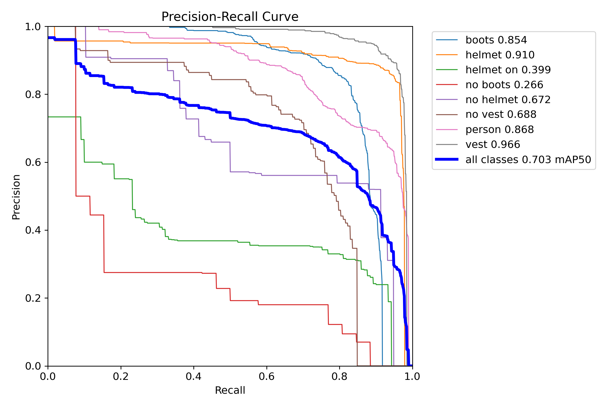

# Kết quả YOLO11s trên PPE-5

Nguồn: `ppe_yolo11s-2_results.zip` và `ppe-yolo11-kaggle (1).ipynb`, chạy ngày 18/11/2026.
Model dùng 8 lớp theo đúng thứ tự trong `source_data.yaml` và checkpoint metadata.

## Kết quả validation

| Params (M) | GFLOPs | P | R | F1 | mAP50 | mAP50–95 | Latency inference (ms/ảnh) |
| ---: | ---: | ---: | ---: | ---: | ---: | ---: | ---: |
| 9.4159 | 21.4349 | 0.6098 | 0.8041 | 0.6829 | 0.7028 | 0.4426 | 10.3133 |

P/R/F1/mAP dùng thang 0–1. Các độ đo được giữ nguyên từ ZIP.

| ID | Lớp | mAP50 |
| ---: | --- | ---: |
| 0 | boots | 0.8535 |
| 1 | helmet | 0.9102 |
| 2 | helmet on | 0.3992 |
| 3 | no boots | 0.2659 |
| 4 | no helmet | 0.6719 |
| 5 | no vest | 0.6880 |
| 6 | person | 0.8676 |
| 7 | vest | 0.9661 |

## Cấu hình thực nghiệm

- Dataset: `/kaggle/input/datasets/duydq206/ppe5-data/ppe-5/data`.
- Model khởi tạo: `yolo11s.pt`; tên lần chạy: `ppe_yolo11s-2`.
- 100 epochs, ảnh 640, batch 16, seed 42, patience 20.
- mAP50–95 validation cao nhất trong `results.csv` ở epoch 92.
  Validation lại `best.pt` có thể khác nhẹ so với số liệu tại epoch đó.
- GPU: Tesla T4; Ultralytics 8.4.215; PyTorch 2.11.0+cu128.
- Params/GFLOPs tính sau fuse, với input `[1, 3, 640, 640]`.
- P/R/F1 lấy tại ngưỡng confidence do Ultralytics chọn để tối đa hóa F1 trung bình
  ở IoU 0.5. Đây không phải P/R/F1 được cố định tại ngưỡng predict 0.5.
- Predict chạy từng ảnh validation với `conf=0.5`, xuất 555 ảnh. Chưa có bước tuning
  confidence hoặc đánh giá/predict trên test trong notebook này.

Latency là inference trung bình mỗi ảnh khi validation batch 16, FP32. Preprocess
1.0092 ms, postprocess 1.0368 ms; tổng ba công đoạn 12.3593 ms/ảnh. Các số này loại
trừ đọc/ghi file và chưa phải benchmark batch 1 hay tốc độ webcam toàn hệ thống.

## Số ảnh và cảnh báo dữ liệu

| Split | Ảnh tìm thấy | Bị bỏ qua do nhãn lỗi | Ảnh được sử dụng |
| --- | ---: | ---: | ---: |
| Train | 3.537 | 12 | 3.525 |
| Validation | 555 | 3 | 552 |

Log notebook có cảnh báo `labels mix segment and detection rows` và cảnh báo trộn
box/segment. Ultralytics bỏ qua 12 ảnh train và 3 ảnh validation; dòng đánh giá
cuối cùng xác nhận **552 ảnh validation, 2.969 instances**. Số lượng tìm thấy trong
JSON gốc chỉ đếm file ảnh, chưa trừ các ảnh bị bỏ qua.

`source_summary.json` giữ nguyên số đếm gốc. `summary.json` dùng số ảnh thực tế sau
khi loại ảnh lỗi, đồng thời lưu `train_images_found`, `val_images_found` và số ảnh
bị bỏ qua để đối chiếu. Trước lần train tiếp theo cần chuẩn hóa nhãn detection;
báo cáo này không tự sửa nhãn hoặc chạy lại model.

## Các file kết quả

- `summary.json`, `metrics_summary.csv`: độ đo và metadata của lần chạy mới.
- `source_summary.json`, `source_metrics_summary.csv`, `source_data.yaml`: file gốc từ ZIP.
- `results.csv`, `results.png`, `args.yaml`: lịch sử và cấu hình huấn luyện.
- `per_class_map50.csv`: mAP50 theo 8 lớp.
- `environment.txt`: môi trường Kaggle để tham chiếu.
- Confusion matrix, F1/PR curves và `examples/`: output mới từ ZIP.
- `models/yolo11s/metadata.json`: SHA256 của checkpoint, ZIP và notebook nguồn.

Không so sánh trực tiếp mAP tổng hợp với lần chạy 4 lớp trước: số lớp, dataset và
tập đánh giá đã thay đổi. Hai lớp `no boots` và `helmet on` có mAP thấp nhất; chưa
có kết quả test độc lập để kết luận khả năng tổng quát hóa.

